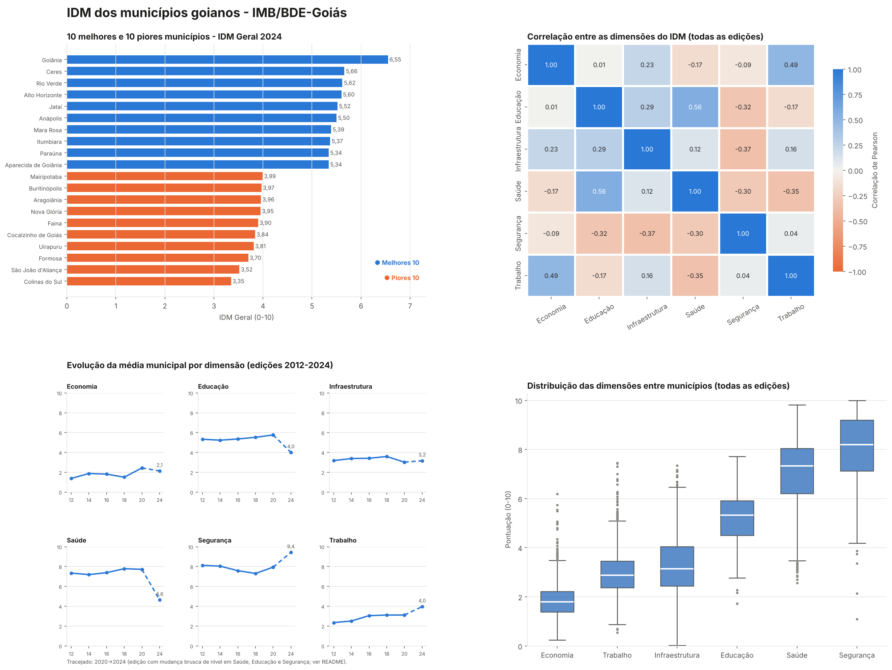
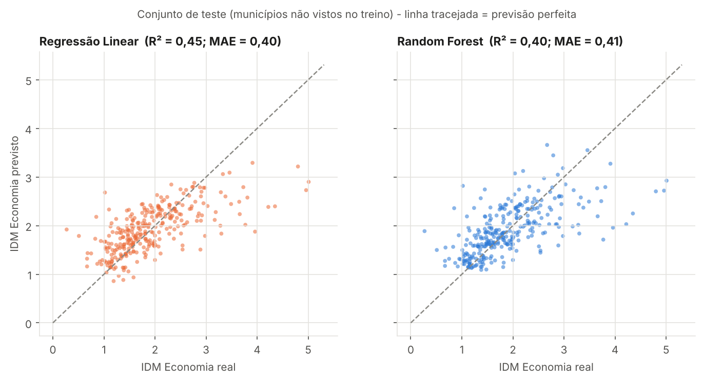
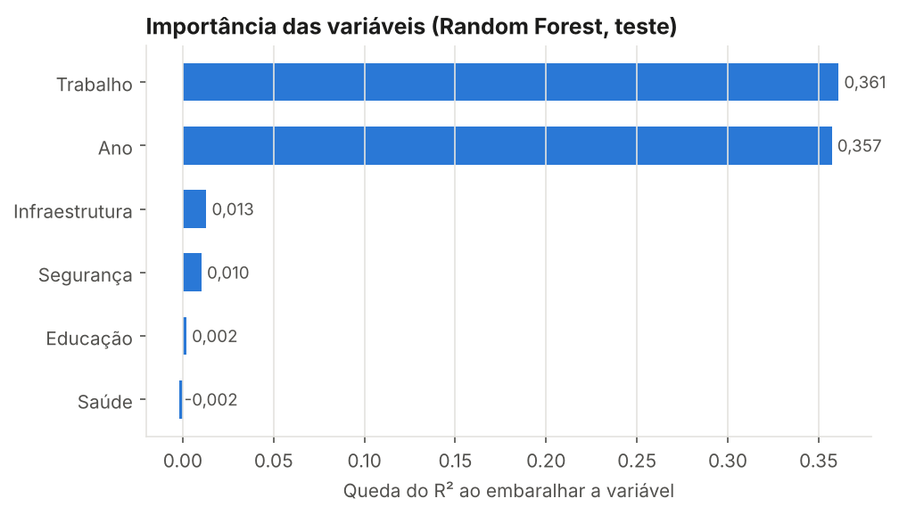

# Desempenho dos municípios goianos: análise e previsão do IDM Economia

**Disciplina:** Big Data e Data Science · **Professor:** Reinaldo Jr · **FATESG 2026/01**
**Integrantes:** _(Rafael Alves Aquino,Diogo de Souza Pereira e Marco Antonio Souza Gomes)_
**Data de entrega/apresentação:** 17/11/2026

---

## 1. Resumo do projeto

O projeto analisa o **Índice de Desempenho dos Municípios (IDM)**, publicado pelo Instituto Mauro Borges (IMB) do Governo de Goiás. O IDM resume o contexto socioeconômico dos **246 municípios goianos** em seis dimensões (Economia, Educação, Infraestrutura, Saúde, Segurança e Trabalho), em edições bianuais.

O trabalho tem três partes, conforme o enunciado:

| Requisito | O que foi feito | Onde está |
|---|---|---|
| **R1** | Coleta, tratamento e documentação completa da base | seção 2 · `data/` |
| **R2** | Dashboard com 4 gráficos | seção 3 · `dashboard/` |
| **R3** | Dois algoritmos de ML (regressão) comparados | seção 4 · `results/` |

**Pergunta de pesquisa:** é possível prever o desempenho econômico de um município (IDM Economia) a partir do seu desempenho nas outras cinco dimensões?

---

## 2. R1 - Coleta e tratamento dos dados

### 2.1 Fonte

- **Origem:** Banco de Dados Estatísticos de Goiás (BDE-Goiás), mantido pelo IMB, tema "IDM". Dados públicos.
- **Consulta:** feita em 15/11/2026, com **todos os municípios**, **todas as 44 variáveis do IDM** e as edições **2012, 2014, 2016, 2018, 2020 e 2024**, exportada em CSV (`data/consulta_idm_bde.csv`).
- **Estrutura original:** 12.300 linhas (246 municípios × 50 linhas de variáveis), uma coluna por edição, separador `;`, codificação cp1252 e vírgula decimal.

### 2.2 Resumo analítico

O IDM é um indicador sintético. Cada dimensão é composta por indicadores específicos, todos em **pontuação de 0 a 10**, e o **IDM Geral** é a média simples das seis dimensões (correlação de 0,992 com a média calculada por nós, verificada no código). Cada linha da base tratada representa **um município em uma edição**, no total de **1.476 linhas** (246 × 6) e **46 colunas**.

### 2.3 Tratamento aplicado

1. **Leitura** com a codificação e o separador corretos e conversão da vírgula decimal para ponto.
2. **Limpeza dos nomes:** remoção do sufixo `()` nas variáveis.
3. **Duplicatas:** foram removidas 1.476 linhas duplicadas. Os títulos de cada dimensão (ex.: "IDM Economia") aparecem uma vez no topo e outra como cabeçalho do grupo na exportação do BDE.
4. **Reestruturação:** de "uma linha por variável" para "uma linha por município e ano" (formato adequado para análise e ML).
5. **Valores nulos:**
   - **Nulo pontual:** 1 valor em `IDM Segurança` (Lagoa Santa, 2012). É imputado pela **mediana** dentro do pipeline de ML (ajustada só no treino).
   - **Ausência estrutural:** alguns indicadores não existem em certas edições. Ficaram vazios (não imputados) e fora do modelo, pois não faria sentido inventar valores:

     | Indicador | Edições sem dado |
     |---|---|
     | Adequação dos professores (fundamental e médio) | 2012, 2014 e 2024 |
     | Adequação dos professores (infantil) | 2012 e 2014 |
     | Equilíbrio orçamentário do município | 2024 |
     | Crimes contra a pessoa, patrimônio, dignidade sexual, contravenções e tráfico de drogas | 2024 |

6. **Normalização:** todas as colunas já estão na mesma escala (0 a 10). Para os modelos, as variáveis são **padronizadas (z-score)** dentro do pipeline, ajustadas apenas no conjunto de treino para evitar vazamento.
7. **Prevenção de vazamento (data leakage):** o IDM Geral **não** é usado como alvo nem como variável de entrada, porque é a média das próprias dimensões. O alvo (IDM Economia) também não é previsto a partir dos seus próprios indicadores componentes.

### 2.4 Dicionário de colunas

Todas as colunas de pontuação estão em **escala de 0 a 10** (unidade: pontos) e vêm do **IMB / BDE-Goiás**. O dicionário completo, com edições disponíveis, mínimo, máximo, média e % de nulos de cada coluna, está em [`data/dicionario_colunas.csv`](data/dicionario_colunas.csv).

| Coluna | Descrição |
|---|---|
| `Localidade` | Nome do município (246) |
| `Ano` | Edição do IDM (2012, 2014, 2016, 2018, 2020, 2024) |
| `IDM Geral` | Índice geral = média das 6 dimensões |
| `IDM Economia`, `IDM Educação`, `IDM Infraestrutura`, `IDM Saúde`, `IDM Segurança`, `IDM Trabalho` | Índice de cada dimensão |

**Indicadores componentes de cada dimensão:**

| Dimensão | Indicadores |
|---|---|
| **Economia** | Equilíbrio orçamentário do município; Evolução do PIB; PIB per capita; Recursos próprios; Setor agropecuário; Setor industrial; Setor de Serviços |
| **Educação** | Adequação dos professores (infantil, fundamental e médio); Atendimento educacional (4 a 5, 6 a 14 e 15 a 17 anos); IDEB 5º ano; IDEB 9º ano |
| **Infraestrutura** | Infraestrutura dos prédios das escolas públicas urbanas; Cobertura de água tratada; Cobertura de energia elétrica; Cobertura de esgoto; Cobertura de telefonia fixa e internet |
| **Saúde** | Cobertura ESF; Cobertura vacinal tetravalente; Cobertura ESF - Saúde Bucal; Leitos SUS por 1.000 hab.; Médicos SUS por 1.000 hab.; Mortalidade infantil; Morte por causas externas (violentas); Pré-natal com 7 consultas |
| **Segurança** | Crimes contra a dignidade sexual; Crimes contra a pessoa; Crimes contra o patrimônio; Contravenções penais; Tráfico de drogas |
| **Trabalho** | Empregos formais; Nível de escolaridade dos trabalhadores; Remuneração mediana; Variação do número de empregos formais |

> A definição técnica e a fórmula de cada indicador estão na metodologia oficial do IDM (publicação do IMB, [Estudo 008/2025](https://goias.gov.br/imb/wp-content/uploads/sites/29/2025/11/Estudo_008_2025_Indice_de_Desempenho_dos_Municipios_.pdf)).

### 2.5 Limitação importante: a edição 2024

Na edição 2024 as médias de algumas dimensões mudam bruscamente em relação a 2020: **Saúde cai de 7,7 para 4,6**, **Educação de 5,8 para 4,0** e **Segurança sobe de 7,9 para 9,4**. Vários indicadores também deixam de existir nessa edição (tabela acima), o que é coerente com **mudança de metodologia ou de composição do índice**. Essa hipótese deve ser confirmada no estudo do IMB. Por isso, comparações entre 2024 e as edições anteriores devem ser feitas com cautela, e a edição entra no modelo B como variável explícita.

---

## 3. R2 - Dashboard de visualização

Painel completo: [`dashboard/dashboard.html`](dashboard/dashboard.html) (abre direto no navegador) e [`dashboard/dashboard.png`](dashboard/dashboard.png).



### Leitura dos gráficos

1. **Ranking (10 melhores e 10 piores, IDM Geral 2024).** Goiânia lidera com 6,55, bem acima do 2º colocado (Ceres, 5,66). Os melhores são cidades grandes ou polos regionais (Rio Verde, Jataí, Anápolis, Aparecida de Goiânia). Os piores ficam em torno de 3,4 a 4,0, com Colinas do Sul (3,35) e São João d'Aliança (3,52) no fim da lista.
2. **Mapa de calor de correlação.** As relações mais fortes são **Educação × Saúde (0,56)** e **Economia × Trabalho (0,49)**. A **Segurança** tem correlação negativa com Infraestrutura (-0,37), Educação (-0,32) e Saúde (-0,30). Uma hipótese é que municípios maiores e mais estruturados registram mais ocorrências, o que reduz a pontuação de segurança (hipótese, não testada aqui). Economia quase não se relaciona com Educação (0,01).
3. **Evolução por dimensão.** Trabalho sobe de forma contínua (2,4 em 2012 para 4,0 em 2024). Economia oscila e tem pico em 2020 (2,4). O tracejado indica a quebra de nível da edição 2024 (seção 2.5).
4. **Boxplot por dimensão.** Economia é a dimensão mais baixa e concentrada (mediana ~1,8, com muitos municípios atípicos acima de 3,5). Segurança e Saúde têm as maiores medianas. Infraestrutura tem a maior dispersão.

Outros gráficos usados na modelagem: [`05_previsto_vs_real.png`](dashboard/05_previsto_vs_real.png) e [`06_importancia.png`](dashboard/06_importancia.png).

---

## 4. R3 - Modelagem preditiva (Machine Learning)

### 4.1 Definição do problema e justificativa

- **Alvo:** `IDM Economia`, uma pontuação **numérica contínua** (0,25 a 6,19). Por isso o problema é de **regressão**, e não de classificação.
- **Variáveis de entrada:** as outras cinco dimensões (Educação, Infraestrutura, Saúde, Segurança e Trabalho).
- **Duas especificações:**
  - **A:** apenas as 5 dimensões.
  - **B:** as 5 dimensões + a **edição (Ano)**, em one-hot, para capturar diferenças de nível entre as edições (seção 2.5).
- **Por que não usar o IDM Geral?** Porque ele é a média das dimensões, inclusive da própria Economia, o que causaria vazamento.

### 4.2 Algoritmos escolhidos

| Algoritmo | Por que foi escolhido |
|---|---|
| **Regressão Linear** | Modelo simples e interpretável. Serve de referência e mostra o peso de cada dimensão. |
| **Random Forest** | Captura relações não lineares e interações entre dimensões, sem exigir que a relação seja linear. |
| **Baseline (média)** | Só para comparação: um modelo que prevê sempre a média. |

### 4.3 Processo de treinamento

1. **Divisão por município:** 80% dos municípios para treino (196) e 20% para teste (50), com `random_state = 42`. Como cada município aparece em 6 edições, dividir linhas ao acaso colocaria o mesmo município no treino e no teste e inflaria o resultado. A divisão por município evita isso.
2. **Pipeline:** imputação pela mediana, padronização (z-score) e one-hot do Ano (na especificação B), tudo ajustado só no treino.
3. **Random Forest:** 300 árvores, com `max_depth` ∈ {4, 8, sem limite} e `min_samples_leaf` ∈ {1, 3, 5} escolhidos por `GridSearchCV` com validação cruzada agrupada por município (3 folds) apenas no treino. Melhor combinação: profundidade 4 e folha mínima 5 (A) e profundidade 8 e folha mínima 5 (B).
4. **Validação cruzada adicional:** 5-fold agrupada por município (`GroupKFold`) sobre toda a base.

### 4.4 Resultados

Métricas no **conjunto de teste** (50 municípios não vistos no treino) e R² médio na validação cruzada:

| Especificação | Modelo | R² (teste) | MAE | RMSE | R² (CV 5-fold) |
|---|---|---|---|---|---|
| A: 5 dimensões | Baseline (média) | -0,005 | 0,566 | 0,758 | -0,016 |
| A: 5 dimensões | Regressão Linear | **0,270** | **0,489** | **0,646** | **0,205 ± 0,109** |
| A: 5 dimensões | Random Forest | 0,233 | 0,496 | 0,662 | 0,144 ± 0,094 |
| B: 5 dimensões + Ano | Baseline (média) | -0,005 | 0,566 | 0,758 | -0,016 |
| B: 5 dimensões + Ano | Regressão Linear | **0,455** | **0,400** | **0,558** | **0,437 ± 0,094** |
| B: 5 dimensões + Ano | Random Forest | 0,395 | 0,412 | 0,588 | 0,400 ± 0,090 |



**Importância das variáveis (Random Forest B, queda do R² ao embaralhar cada variável no teste):**

| Variável | Importância |
|---|---|
| Trabalho | 0,361 |
| Ano (edição) | 0,357 |
| Infraestrutura | 0,013 |
| Segurança | 0,010 |
| Educação | 0,002 |
| Saúde | -0,002 |



### 4.5 Comparação entre os algoritmos e interpretação

- **Os dois modelos superam o baseline** (R² próximo de zero), então as outras dimensões têm algum poder de previsão sobre a Economia.
- **A Regressão Linear ficou um pouco à frente do Random Forest** nas duas especificações, tanto no teste quanto na validação cruzada. A diferença (entre 0,04 e 0,06 de R²) é menor que o desvio entre folds (~0,09), então **os dois modelos têm desempenho semelhante**. O resultado sugere que a relação é, em grande parte, aproximadamente linear e que a base é pequena (1.476 linhas) para o Random Forest ganhar com a flexibilidade extra.
- **Quase todo o poder de previsão vem de duas fontes:** a dimensão **Trabalho** (coerente com a correlação de 0,49 vista no dashboard) e a **edição**. Infraestrutura contribui pouco, e Educação, Saúde e Segurança praticamente nada.
- **O efeito da edição** (R² sobe de 0,27 para 0,45 na Regressão Linear) mostra que o nível da Economia varia entre as edições, por exemplo com o pico de 2020. Como o Ano não é uma característica do município, a especificação B **não serve para prever uma edição futura**. A especificação A é a versão mais limpa para essa finalidade.

### 4.6 Limitações

- O desempenho é **moderado** (R² máximo de 0,45): as demais dimensões explicam só parte da economia municipal.
- A população dos municípios **não estava** na consulta do BDE e não foi usada como variável.
- Foi trabalhado só com regressão. A classificação em faixas (alto, médio e baixo) ficou como extensão possível.
- Os dados cobrem 6 edições bianuais, com mudança de nível em 2024.

---

## 5. Conclusões

1. A base do IDM é de boa qualidade para análise: 246 municípios, 6 edições e apenas 1 valor nulo nas seis dimensões principais. Os problemas relevantes são a duplicação na exportação e os indicadores que deixam de existir em 2024.
2. O desempenho econômico municipal está mais ligado ao **mercado de trabalho** do que à educação, saúde ou segurança. Isso aparece na correlação (0,49) e na importância dos modelos.
3. Goiânia lidera o IDM Geral de 2024 com folga, e os piores resultados estão em municípios pequenos.
4. **Regressão Linear e Random Forest** chegaram a resultados parecidos (R² de 0,45 e 0,40 no teste, MAE de 0,40 e 0,41). O modelo simples foi igual ou melhor, o que é comum em bases pequenas e com poucas variáveis úteis.
5. Para melhorar a previsão seria preciso incluir variáveis externas (população, estrutura produtiva, arrecadação) e confirmar a metodologia da edição 2024.

---

## 6. Como reproduzir

```bash
pip install -r requirements.txt
python src/analise_idm.py
```

O script lê `data/consulta_idm_bde.csv` e gera a base tratada, o dicionário, os gráficos, o dashboard e as métricas. O mesmo código está em `notebooks/analise_idm.ipynb` (para abrir no Colab ou Jupyter, executar a partir da raiz do repositório).

## 7. Estrutura do repositório

```
├── README.md
├── requirements.txt
├── data/
│   ├── consulta_idm_bde.csv            # exportação original do BDE-Goiás
│   ├── idm_municipios_processado.csv   # base tratada (município × ano)
│   └── dicionario_colunas.csv          # dicionário de todas as colunas
├── src/analise_idm.py                  # pipeline completo
├── notebooks/analise_idm.ipynb         # mesmo código em formato notebook
├── dashboard/                          # gráficos, dashboard.png e dashboard.html
└── results/                            # métricas dos modelos e importâncias
```

## 8. Referências

- Instituto Mauro Borges (IMB) - Governo de Goiás. **Banco de Dados Estatísticos de Goiás (BDE)** e **Índice de Desempenho dos Municípios (IDM)**. <https://goias.gov.br/imb/>
- IMB. **Estudo 008/2025 - Índice de Desempenho dos Municípios**, 2025.
- Pedregosa et al. **Scikit-learn: Machine Learning in Python.** JMLR 12, 2011.
